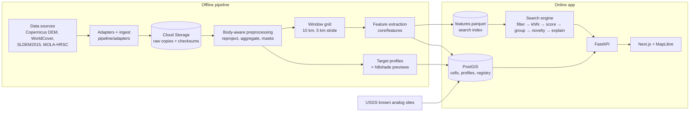

# Architecture

> Code exists for every component below (2026-11-14). File-by-file flow: [WALKTHROUGH.md](WALKTHROUGH.md).

## Big picture

Two halves:
1. **Offline pipeline** (CLI, runs on the VM): downloads data, preprocesses it, cuts Earth into windows, computes features. Slow, runs rarely.
2. **Online app** (FastAPI + Next.js): searches the precomputed features. Fast, runs on every user click.



## Components

| Component | Tech | Responsibility | Location |
|---|---|---|---|
| Core library | Python 3.12, NumPy, Rasterio, PyProj, Shapely | Body constants/CRS, raster ops, features, scoring, grid. Pure functions, heavily tested | `core/` |
| Pipeline CLI | Typer | `ingest`, `preprocess`, `windows`, `extract`, `target`, `seed-fake` commands | `pipeline/` |
| Backend | FastAPI, Pydantic, SQLAlchemy, Alembic | API, search engine, registry check, reviews | `backend/` |
| Frontend | Next.js, TypeScript, MapLibre GL JS | Target picker, results map, evidence panel | `frontend/` |
| Database | PostgreSQL 16 + PostGIS | Cells, profiles, targets, registry, searches, candidates, reviews, provenance | Docker container |
| Object storage | MinIO (local) / Cloud Storage (VM) | Raw DEM copies, derived rasters, previews, backups | — |
| Reverse proxy | Caddy | HTTPS, routes `/api` → backend, `/` → frontend | `infra/Caddyfile` |

## Hackathon vs full design

| Aspect | Hackathon (build now) | Full design (later) |
|---|---|---|
| Long jobs | None — features precomputed by CLI in the backend image | Celery + Redis workers, job states |
| `POST /searches` | Runs inline, status `completed`, no polling. Missing features → 409 `features_not_ready` | May return 202 and poll |
| Search index | `features.parquet` only. PostGIS `feature_profiles` is the evidence store. Checksums must match | Same, plus cached results keyed by versions |
| Regions | `earth_atacama` and `earth_sahara` from `config/grids/pilot-v1.yaml` | User-drawn areas, on-demand processing |
| Review | One button + shared demo token | Roles, audit trail, status transitions |
| Evaluation | One benchmark notebook (D-022) | Holdouts, sensitivity sweeps, report |
| ML | None | None (ML is out of scope; see D-001) |

## Deployment topology (GCP)

```
Internet ──443──> Caddy ──> frontend (Next.js, :3000)
                      └──> backend  (FastAPI, :8000) ──> PostGIS (:5432, internal only)
                                         └──> Cloud Storage bucket (via VM service account)
All on one Compute Engine VM (e2-standard-4), Docker Compose.
```

## Coordinate systems (critical)
- Earth: store geometry in EPSG:4326; process each pilot region in its own Lambert Azimuthal Equal-Area projection.
- Moon: IAU_2015:30100 (sphere R = 1,737,400 m). Mars: IAU_2015:49900 (sphere R = 3,396,190 m). Process targets in a local LAEA on that sphere, centered on the scored point in `config/targets/`. Do not use a WGS84 datum for either body.
- PostGIS SRIDs are Earth-only; planetary geometries are stored as GeoJSON/WKT + `body` + `crs` columns.

## Data model
See IMPLEMENTATION_PLAN.md §5 for tables. Hackathon uses: `earth_cells`, `feature_profiles`, `planetary_targets`, `known_analog_registry`, `search_jobs`, `candidate_matches`, `review_records`, `source_assets`, `processing_runs`.

Search reads `features.parquet` (one region, one `scale_m`). Evidence reads `feature_profiles`. The parquet SHA-256 is stored on the processing run; a mismatch refuses the search (D-019). Canonical ids: `mars_jezero`, `moon_taurus_littrow`, `earth_atacama`, `earth_sahara`.
