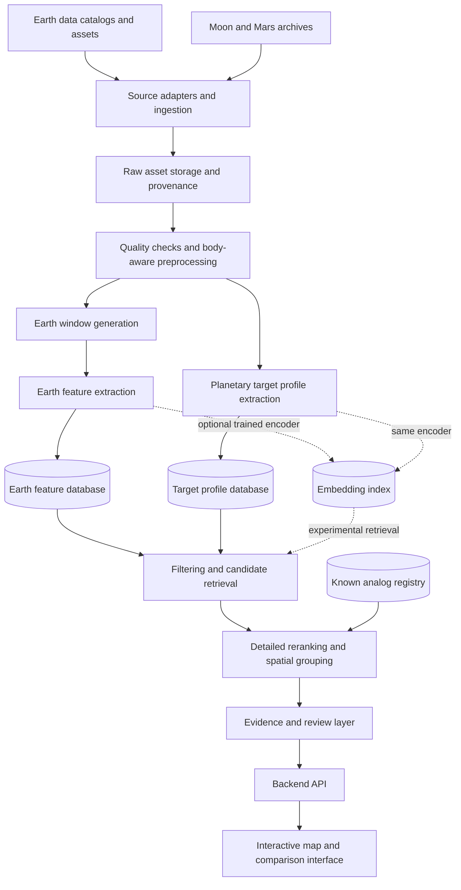

# Earth Analog Explorer — Project Overview and System Design

> Markdown copy of the original design PDF (`earth_analog_explorer_system_design.pdf`), kept here so humans and AI agents can read it without the PDF.
> This is the **source design**. Where the implementation deliberately differs (no ML for now, hackathon simplifications, chosen datasets), [IMPLEMENTATION_PLAN.md](../IMPLEMENTATION_PLAN.md) and [docs/DECISIONS.md](DECISIONS.md) win.

A proposed hybrid geospatial discovery platform for identifying potentially new Earth analog candidates for selected lunar and Martian environments.

---

## 1. Introduction

Earth Analog Explorer searches Earth observation data for regions that share measurable characteristics with specific locations on the Moon or Mars. Instead of limiting users to an existing catalog of analog sites, it generates geographic search windows, evaluates their terrain and available environmental evidence, and returns explainable candidate matches.

The project combines interpretable mathematical comparisons with an experimental machine-learning retrieval component. Its purpose is to support analog-site investigation, equipment-testing planning, and geological research — not to certify landing safety or claim that Earth can reproduce an entire extraterrestrial environment.

**Primary objectives**
- Discover candidate regions beyond a predefined list of known analogs.
- Compare specific planetary targets rather than an entire planet in the abstract.
- Explain similarities, differences, missing evidence, and measurement limitations.
- Separate environmental similarity from novelty, data coverage, and fieldwork practicality.
- Evaluate whether learned terrain representations improve on a transparent mathematical baseline.

## 2. Problem Statement

Finding useful terrestrial analogs requires more than identifying landscapes that look similar to the Moon or Mars. A region may match a planetary target in terrain but differ in geology, thermal behavior, or surface materials. Existing named analog sites are useful references, but restricting the search to those sites does not address the discovery of additional candidates.

**Core problem:** How can open Earth and planetary datasets be used to automatically search broad Earth regions, identify previously unlisted candidate analogs, and explain the evidence and uncertainty behind each match?

**Main challenges**
- Different spatial resolutions, coordinate systems, and observation periods.
- Incomplete or geographically uneven geological and environmental coverage.
- Lack of a comprehensive registry that can prove a candidate has never been studied.
- Risk of confusing visual resemblance with physical similarity.
- Risk of generating opaque scores or treating missing measurements as evidence.
- Computational cost of searching large raster collections.

## 3. Proposed Solution

Develop an interactive application backed by an offline geospatial processing pipeline and an online discovery engine.

Users select a lunar or Martian target, a comparison purpose, and an Earth search boundary. The system searches prepared Earth feature profiles, retrieves similar regions, performs detailed reranking, groups overlapping results, and checks candidates against documented analog references.

Each result includes:
- Candidate location and evaluated boundary.
- Planetary target and comparison footprint.
- Feature-level measurements and similarity scores.
- Optional learned-representation similarity, labeled separately.
- Data coverage, source resolution, processing versions, and provenance.
- Important mismatches and unavailable evidence.
- Known-site overlap and novelty-review status.

### Novelty policy
A location missing from our registry is not automatically a new scientific discovery. Results use labels such as:
1. Documented analog.
2. Candidate not found in checked reference records.
3. Candidate undergoing literature or expert review.

Record which catalogs and literature were checked and the review date. Exclude known-site boundaries from the default potentially-new-candidate results while retaining them for benchmarking. Documented sites may still appear in a separate reference view.

## 4. Scope

**Initial release**
- One lunar target and one Martian target, introduced incrementally.
- Broad pilot Earth regions rather than an immediate global scan.
- Automatically generated cells and overlapping comparison windows.
- Terrain-based retrieval and scoring.
- Geological and landform evidence where reliable coverage exists.
- Interactive map, source panel, comparison view, and exported results.
- Known-analog registry and review workflow.

**Later extensions**
- Wider geographic coverage and additional target profiles.
- Trained terrain encoder and hybrid retrieval experiments.
- Compatible surface-temperature and illumination comparisons.
- Expert-reviewed training pairs and optional similarity-model fine-tuning.
- Fieldwork logistics displayed separately from environmental similarity.

## 5. Comparison Framework

| Feature group | Proposed measures | Notes |
|---|---|---|
| Slope | Median, 90th percentile, histogram | Degrees; derive consistently from elevation |
| Relief | High-minus-low elevation percentile range | Metres within a declared footprint |
| Roughness | Detrended elevation variation | State the physical measurement scale |
| Landforms | Classes or class proportions | Use documented maps or validated classifications |
| Geology | Broad rock/mineral categories | Optional where reliable coverage exists |
| Thermal (later) | Surface-temperature statistics and range | Do not substitute air temperature |
| Illumination (later) | Sunlit fraction and continuous darkness | Use explicit time windows and geometry |

**Harmonization rules**
- Keep Earth, Moon, and Mars coordinate reference systems distinct.
- Use the correct planetary geometry for distances and derivatives.
- Compare matching physical footprints and compatible effective resolutions.
- Do not manufacture fine-scale information by upsampling coarse data.
- Preserve units, measurement type, observation period, and quality flags.
- Keep missing values explicit.
- Treat global thresholds and initial window sizes as configurable project assumptions.

## 6. System Architecture



**Architectural principle:** heavy raster ingestion and processing run asynchronously. Interactive searches operate mainly on prepared features. A new target requiring extraction creates a background job rather than blocking an API request.

## 7. Data Resources and Access

| Source | Intended use | Implementation note |
|---|---|---|
| NASA Planetary Data System | Discover and retrieve mission products | Discovery APIs and archive files have different roles |
| LRO LOLA | Lunar elevation and terrain features | Select suitable derived elevation products |
| Mars Global Surveyor MOLA | Martian elevation and regional terrain | Respect product resolution |
| LRO Diviner | Optional lunar surface-temperature evidence | Preserve measurement and temporal meaning |
| MRO CRISM | Optional Martian mineralogical evidence | Requires specialized preprocessing and coverage checks |
| Earth elevation catalogs | Earth terrain feature extraction | Select products after coverage and resolution audit |
| Earth geological maps | Geological context | Track scale, classifications, and licensing |
| STAC-compatible catalogs | Discover geospatial assets | STAC describes assets; it does not compute similarity |
| NASA POWER | Optional Earth climate context | Air temperature is not a substitute for surface temperature |

Public archive access does not imply identical authentication rules across all providers. Adapters must support provider-specific credentials, signed links, rate limits, retries, and access-policy changes. Never expose secrets in the browser.

## 8. Candidate Discovery Pipeline

1. **Configure a search profile** — target boundary, Earth search area, mandatory features, comparison scale, scoring version.
2. **Generate Earth candidates** — tile the search region into equal-area cells or overlapping windows. Initial proposed footprint 10 km × 10 km, with larger context windows where useful. These values must be tested, not treated as universal standards.
3. **Apply eligibility filters** — filter unusable data and profile-incompatible surfaces (missing elevation coverage, ocean for a land search, dense development for exposed-terrain testing). Snow, ice and vegetation exclusions depend on the selected purpose.
4. **Extract comparable features** — compute the same available measures for each Earth window and planetary target. Store source IDs and processing versions with the derived values.
5. **Retrieve candidates** — apply mandatory data-coverage constraints and retrieve nearby numeric profiles. (Experimental ML version: also retrieve by learned embeddings and take the union for reranking.)
6. **Rerank with evidence** — compare slope distributions, relief, roughness, optional geology. Rank on common mandatory features to avoid rewarding candidates simply because difficult features are missing.
7. **Group nearby results** — suppress duplicate overlapping windows or combine them into candidate regions. Preserve the original windows used to calculate scores; do not imply every point in a merged polygon has the same match quality.
8. **Check novelty and explain** — check known-site overlap, attach review status, generate deterministic explanations from measured differences. Literature review and expert assessment remain necessary before stronger novelty claims.

## 9. Mathematical Baseline and Machine Learning

### 9.1 Interpretable baseline
For a numeric feature *i*:

```
difference_i = abs(earth_i - target_i)
similarity_i = 100 * max(0, 1 - difference_i / tolerance_i)
```

A weighted mean can combine the mandatory available feature scores. Tolerances and weights must be visible, versioned, and sensitivity-tested. Histograms and categorical features require appropriate separate comparison functions.

This score is a configured similarity measure, not a probability of scientific validity. Standardized nearest-neighbor retrieval alone does not imply that the similarity representation was learned.

### 9.2 Experimental ML component — **out of scope for now**
Train a self-supervised contrastive encoder on elevation patches; embed Earth and planetary inputs with the same encoder; compare retrieval with the baseline on geographic holdouts; test domain shift. Keep ML similarity separate until validated.

### 9.3 Hybrid strategy — **out of scope for now**
Union of explicit-feature and embedding retrieval, reranked with interpretable measurements. An optional language model may summarize structured evidence, but must not create measurements, determine novelty, or fill missing values.

## 10. Technology Stack

| Layer | Technology | Responsibility |
|---|---|---|
| Frontend | Next.js, TypeScript | Search, comparison, review interface |
| Earth map | MapLibre GL JS | Candidate boundaries and map interaction |
| Backend | FastAPI, Pydantic | Validated APIs and orchestration |
| Raster processing | Python, GDAL, Rasterio, NumPy | Raster preparation and derivatives |
| Vector processing | GeoPandas, Shapely, PyProj | Geometry and coordinate operations |
| Catalog access | STAC client and source-specific adapters | Asset discovery |
| Metadata store | PostgreSQL, PostGIS | Spatial records, jobs, provenance |
| Feature search | Numeric arrays / nearest-neighbor index | Baseline retrieval |
| Optional vector search | pgvector or FAISS (ML, out of scope) | Embedding retrieval |
| ML experimentation | PyTorch, scikit-learn (ML, out of scope) | Encoder training and evaluation |
| Background jobs | Celery, Redis | Long-running processing tasks |
| Object storage | S3-compatible storage | Source subsets, derived rasters, previews |
| Deployment | Docker Compose initially | Reproducible application services |

Start with a modular backend and worker services. Add distributed processing only after measuring bottlenecks. Planetary target previews can be pre-rendered rather than incorrectly placing lunar or Martian coordinates on an Earth basemap.

## 11. Database Design

| Entity | Key contents |
|---|---|
| source_assets | Provider, body, footprint, resolution, source version, checksum, access metadata |
| processing_runs | Inputs, code version, configuration, status, errors, timestamps |
| earth_cells | Boundary, grid version, parent region, footprint size |
| feature_profiles | Feature values, availability mask, scale, schema version, source references |
| planetary_targets | Body, boundary, profile references, description |
| embeddings | Encoder version, profile reference, vector (ML, out of scope) |
| search_jobs | Target, boundary, filters, scoring version, status |
| candidate_matches | Scored windows, component scores, rank, evidence references |
| known_analog_registry | Documented boundaries, names, references, review date |
| review_records | Candidate, reviewer decision, evidence, novelty status |

Cache keys must include target profile version, Earth feature version, search filters, and scoring/model version. Source or model changes must not silently reuse stale results.

## 12. API Design (internal endpoints, not NASA APIs)

```
GET  /targets
GET  /targets/{target_id}
POST /searches
GET  /searches/{search_id}
GET  /searches/{search_id}/candidates
GET  /candidates/{candidate_id}
GET  /candidates/{candidate_id}/evidence
POST /processing-jobs
GET  /processing-jobs/{job_id}
POST /candidates/{candidate_id}/reviews
```

Example search request:

```json
{
  "target_id": "mars_target_01",
  "profile": "terrain",
  "footprint_m": 10000,
  "search_area_id": "pilot_region",
  "required_feature_groups": ["terrain"],
  "optional_feature_groups": ["geology"],
  "exclude_documented_analogs": true,
  "retrieval_mode": "baseline",
  "top_k": 20,
  "scoring_version": "terrain-v1"
}
```

> The example ids above are the original design sketch. The hackathon uses `mars_jezero`, `moon_taurus_littrow`, `earth_atacama`, and `earth_sahara` (D-018). `POST /searches` runs inline and returns a completed search id (D-017). Copy the request in [docs/WALKTHROUGH.md](WALKTHROUGH.md), not this sketch.

Long-running requests return a job identifier in the full design. The hackathon does not queue them. Jobs in that later design support queued, running, completed, partially completed, failed, and cancelled states. Review and processing endpoints require authorization.

## 13. End-to-End Application Working

1. The user chooses a prepared lunar or Martian target and a comparison purpose.
2. The frontend sends a search request with a boundary and feature requirements.
3. The backend verifies target readiness and available Earth coverage.
4. Missing preprocessing is queued, or the prepared feature index is searched directly.
5. The retrieval engine returns a shortlist.
6. The reranker evaluates comparable evidence and groups spatial duplicates.
7. The registry check separates documented analogs from unlisted candidates.
8. The map displays distinct candidates and feature-level explanations.
9. The user inspects sources, limitations, coverage, and review status.
10. Review decisions and exported summaries retain the complete search configuration.

## 14. Validation and Evaluation

**Scientific and retrieval checks**
- Compare retrieval approaches on the same search areas (baseline only for now).
- Use geographically separated validation regions; prevent overlapping patches from leaking across splits.
- Use documented analogs as reference cases without making them the candidate universe.
- Include negative controls and expert-reviewed candidate pairs.
- Evaluate sensitivity to weights, windows, resolution, and data availability.
- Measure top-k relevance where reviewed labels exist; do not invent ground-truth novelty labels.

**Engineering checks**
- Track preprocessing throughput, job failure rates, query latency, storage growth.
- Measure spatial search coverage and valid-data fractions.
- Test retry safety, reproducibility, stale-cache prevention, source outages.
- Verify units, coordinate handling, raster masks, provenance completeness.

**Success criteria:** the prototype automatically searches non-curated Earth windows, returns reproducible candidate matches, explains their measured similarities, separates known sites from unlisted candidates, and communicates limitations without overstating novelty.

## 15. Operational Design

- Make processing jobs idempotent using input checksums and configuration versions.
- Retry transient source failures with backoff and provider limits.
- Store job logs and actionable failure reasons.
- Restrict arbitrary remote asset URLs to approved sources (SSRF risk).
- Set search-area, job-size, and concurrency limits to control compute costs.
- Keep credentials server-side and redact them from logs and exports.
- Preserve partial-coverage status when some sources fail.
- Store raster assets in object storage rather than large relational database fields.

## 16. Development Roadmap (original)

1. **Data audit and terrain baseline** — pilot coverage, target products, access and licenses, comparable elevation windows, deterministic feature extraction.
2. **Discovery application** — feature index, retrieval, spatial grouping, API, map, evidence panels.
3. **Novelty and validation** — documented-site boundaries, review records, geographic holdouts, sensitivity tests, reproducible exports.
4. **ML experiment** — *out of scope for now.*
5. **Broader environmental evidence** — wider geography, validated geology, compatible thermal and illumination data.

## 17. Limitations and Non-Goals

- Earth analogs match selected properties, not the complete lunar or Martian environment.
- Site selection does not reproduce extraterrestrial gravity, vacuum, radiation, or atmospheric composition.
- Similarity is not landing-site safety certification or proof of resource availability.
- Novelty is bounded by the references checked and review performed.
- Coarse source data cannot resolve fine obstacles or guarantee local accessibility.
- Global discovery requires staged coverage expansion; the pilot must not be described as a completed worldwide survey.

## 18. Expected Outcome

A reproducible, map-based discovery workflow that identifies potentially new terrestrial analog candidates, explains why they match a selected planetary target, and clearly distinguishes measured evidence, learned similarity, missing information, and novelty-review status.

The first useful deliverable is an automatic terrain-search application. Machine learning is a testable enhancement, not a prerequisite for discovering previously unlisted candidates.

## Reference starting points

- NASA Planetary Data System: https://pds.nasa.gov/
- PDS Data Search: https://pds.nasa.gov/datasearch/data-search/
- LRO LOLA archive: https://pds-geosciences.wustl.edu/missions/lro/lola.htm
- LRO Diviner archive: https://pds-geosciences.wustl.edu/missions/lro/diviner.htm
- MRO CRISM archive: https://pds-geosciences.wustl.edu/missions/mro/crism.htm
- NASA Planetary Analog Explorer: https://science.nasa.gov/solar-system/analog-explorer/
- STAC specification: https://stacspec.org/en
- NASA POWER docs: https://power.larc.nasa.gov/docs/
